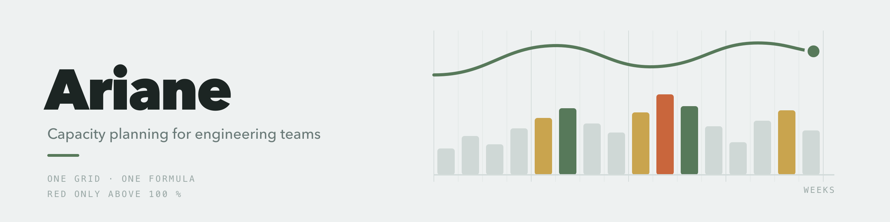

<div align="center">

<picture>
  <source media="(prefers-color-scheme: dark)" srcset=".github/banner-dark.png">
  
</picture>

### Who is on which project, when — and who still has room.

Capacity planning for engineering teams. A twelve-month week grid where a team
lead spreads people across subprojects and **immediately sees who is over
capacity**.

`Next.js 16` · `React 19` · `Postgres` · `Drizzle` · `Tailwind 4`

</div>

---

## Why

In most teams, capacity planning lives in a spreadsheet nobody wants to
maintain. Ariane is an attempt to build exactly that spreadsheet — except it
calculates instead of just holding numbers.

Everything hangs on one formula:

```
available(person, week) = net capacity × (5 − vacation days − holidays) / 5
utilisation             = planned hours / available
```

Net capacity is what's left for project work after meetings and internal
overhead. It only turns red above 100 percent.

## What it does

| | |
|---|---|
| **Week grid** | A little over a year, switchable between weeks and months, hours and percent |
| **Two views** | By person and by project — same data, different grouping |
| **Spreadsheet-style entry** | Click a cell and type. Shift for multi-select, arrow keys to move, ⌘Z to undo |
| **⌘C / ⌘V** | Tab-separated, so Excel is the clipboard. Alt+Arrow shifts an entire assignment by one week |
| **Vacation as a date range** | "Aug 5 to 14" — Ariane works out the working days per week; weekends and holidays don't count |
| **Region-aware holidays** | 16 German states and 12 more countries. What matters is where someone *works*, not where they live |
| **Capacity with an effective date** | Switching to part time doesn't retroactively bend the past |
| **Budget per subproject** | Spent / planned / budget as a single bar |
| **Quotes** | Toggle them in and out; they don't count towards utilisation by default |
| **Reports** | Key figures, weekly trend, utilisation per person, overload blocks, budgets — with a period picker |
| **Excel export** | For the meeting where nobody opens the tool |
| **Drag to reorder** | People, projects, subprojects — by the handle in the name column |
| **Ten colour themes** | Atelier, Nord, Solarized, Dracula, Gruvbox, Tokyo Night, Everforest, Rosé Pine, GitHub, Catppuccin — each with light and dark |

## Colour is information, not decoration

Utilisation stays **neutral up to 85 percent** — a grid where everything is
colourful tells you nothing. Colour only arrives when things get tight: amber
from 85, accent at exactly full, apricot above.

Project colours are identity: the same colour means the same project in every
view. Six fixed tones, checked with a palette validator for lightness band,
chroma, colour vision deficiency and contrast — in both modes. From the seventh
project on it stays neutral; the name is in every row anyway.

## Getting started

```bash
docker compose up -d      # Postgres on port 5444
pnpm install
pnpm db:migrate
pnpm db:seed              # invented but plausible starter data
pnpm dev
```

Environment variables go in `.env.local`, template in `.env.example`.

More on structure, deployment and the design decisions:
**[DEVELOPMENT.md](DEVELOPMENT.md)**

> **Note on language:** the UI and the source comments are in German — the tool
> was built for a German-speaking team. The docs are English.

## License

MIT
